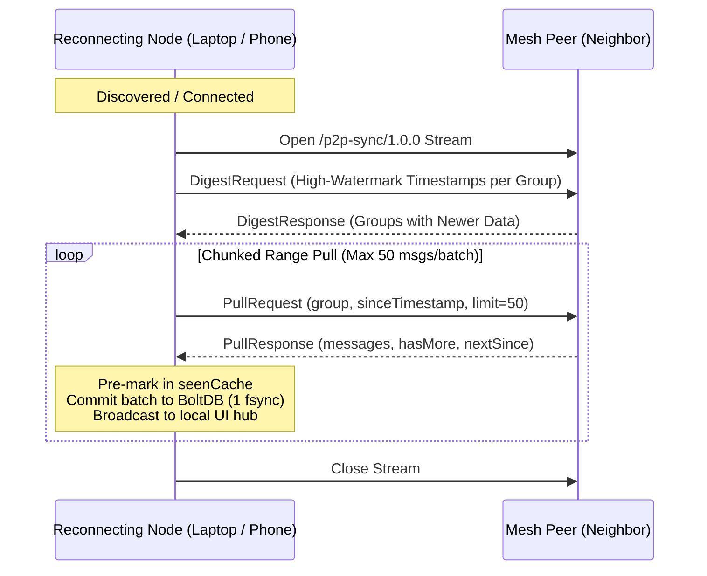

# LANMesh — Serverless Ad-Hoc P2P Mesh Network & Admin Reference System

> **Serverless, peer-to-peer ad-hoc mesh communication over local Wi-Fi, Ethernet, and mobile hotspots.**  
> Zero internet access, zero external cloud dependencies, zero central servers, and no user accounts required. Run the binary on your desktop/laptop or install the APK on your Android phone, and you are immediately live on the mesh.

---

## Table of Contents
1. [Overview & Core Value](#overview--core-value)
2. [System Architecture](#system-architecture)
   - [The "Hopping One Principle" (Multi-Hop Relay Engine)](#the-hopping-one-principle-multi-hop-relay-engine)
   - [Protocol Isolation (`/p2p-chat`, `/p2p-sync`, `/lanmesh-call`, `/lanmesh-pex`)](#protocol-isolation)
   - [Triple-Discovery Engine (mDNS, UDP LAN Beacon, PEX & Subnet Scan)](#triple-discovery-engine)
3. [Decentralized Catch-Up Synchronization Engine (`/p2p-sync/1.0.0`)](#decentralized-catch-up-synchronization-engine-p2p-sync100)
4. [Storage & Database Architecture (BoltDB)](#storage--database-architecture-boltdb)
5. [Admin Node & Forensic Audit Subsystem](#admin-node--forensic-audit-subsystem)
6. [WebRTC Audio/Video Calling & Group Rooms (`/lanmesh-call/1.0.0`)](#webrtc-audiovideo-calling--group-rooms)
7. [Wire Protocol Specifications](#wire-protocol-specifications)
8. [HTTP & WebSocket API Reference](#http--websocket-api-reference)
9. [CLI Flags Reference](#cli-flags-reference)
10. [Build & Deployment Instructions](#build--deployment-instructions)
11. [Android Native Mobile Integration](#android-native-mobile-integration)
12. [Security, Privacy & Known Limitations](#security-privacy--known-limitations)

---

## Overview & Core Value

LANMesh turns standard laptops, PCs, Raspberry Pis, and Android smartphones into an autonomous, self-healing communication cluster. Designed specifically for isolated or degraded networks (disaster response, campus intranets, underground facilities, off-grid expeditions, conference dead-zones):

* **Zero Infrastructure Setup:** Operates on local Wi-Fi, mobile hotspots, or Ethernet switches without internet gateways, external routers, or DNS servers.
* **Full Autonomous P2P Nodes:** Every device—including Android phones—runs its own embedded libp2p host, stores its own BoltDB database, and routes traffic for other peers.
* **Multi-Hop Range Extension:** Devices out of direct Wi-Fi range communicate seamlessly through intermediate devices acting as bridges (up to 6 hops).
* **Forensic Hop Auditing:** Every message carries a `HopTrail` documenting the exact relay path taken across the mesh.
* **Decentralized Anti-Entropy Sync:** Devices that rejoin the network after hours offline automatically sync missed messages in point-to-point chunked streams without needing an admin node.
* **Zero-Knowledge Admin Authentication:** Authoritative admin stations support HMAC-SHA256 challenge-response login without transmitting passwords over the wire.

---

## System Architecture

```
[ LAN 1 Subnet ]                 [ LAN 2 Subnet ]                 [ LAN 3 Subnet ]
┌──────────────┐                 ┌──────────────┐                 ┌──────────────┐
│   Node A     │                 │   Node B     │                 │   Node C     │
│  (Origin)    │                 │  (Mid Relay) │                 │  (Terminal)  │
└──────┬───────┘                 └──────┬───────┘                 └──────┬───────┘
       │                                │                                │
       │ Direct Beacon / TCP            │ Direct Beacon / TCP            │
       ▼                                ▼                                ▼
┌──────────────────────────────┐ ┌──────────────────────────────┐
│      Bridge Laptop 1         │ │     Admin Station (Bridge)   │
│  - Forwards Hop 1 → Hop 2    │ │  - Forwards Hop 2 → Hop 3    │
│  - Appends to HopTrail       │ │  - BoltDB Audit Backfill     │
└──────────────────────────────┘ └──────────────────────────────┘
```

### The "Hopping One Principle" (Multi-Hop Relay Engine)

LANMesh operates as an unmanaged flood-relay mesh with dynamic loop prevention and route recording:

1. **Hop Counter & Bounded TTL:**
   - Messages originate locally with `Hops: 0`.
   - Each forwarding node increments `msg.Hops++`.
   - Messages reaching `maxHops = 6` are dropped from further propagation, preventing infinite packet cycles.
2. **Forensic HopTrail Tracking:**
   - Every intermediate node appends its cryptographic Peer ID to `msg.HopTrail` before relaying.
   - Recipients and administrative logs inspect the exact physical relay route taken across the mesh.
3. **Hop UI Badges & Tooltips:**
   - The Chat UI renders visual status badges next to message timestamps:
     - `⚡ Direct` (1 hop)
     - `🔄 1 relay` (2 hops)
     - `🌐 N hops` (3+ hops)
   - Hovering over any badge displays the full relay trail (e.g. `Route: 12D3KooW... → 12D3KooW...`).
4. **Two-Generation Dedup Cache (`seenCache`):**
   - Each node maintains a rotating two-generation deduplication cache (5,000 entry cap). Any message ID already in the cache is discarded immediately, suppressing broadcast storms and cyclic echoes.
5. **Relay Concurrency Throttling:**
   - A bounded semaphore (`relaySem`, capacity 32) limits simultaneous outbound forwarding streams, protecting mobile CPU and battery during message bursts.
6. **Isolated Fan-Out Goroutines:**
   - Forwarding to neighbors occurs in independent goroutines with 5-second dial timeouts; an unresponsive neighbor cannot stall delivery to other nodes.

---

### Protocol Isolation

Traffic is strictly segregated into dedicated libp2p protocol handlers to avoid head-of-line blocking and voice note stutter:

| Protocol ID | Purpose | Characteristics |
|---|---|---|
| `/p2p-chat/1.0.0` | Live Chat & Media | Multi-hop flood relay, hop increments, two-gen dedup, bounded TTL (6 hops) |
| `/p2p-sync/1.0.0` | Anti-Entropy Catch-Up | Point-to-point, chunked range queries (50 msgs/batch), semaphore cap 2, 45s debounce |
| `/lanmesh-call/1.0.0` | WebRTC Call Signaling | Direct 1:1 & room signaling (SDP/ICE), never relayed multi-hop, never persisted |
| `/lanmesh-pex/1.0.0` | Peer Exchange | Gossip-based peer multiaddress sharing, unblocks hotspot multicast isolation |

---

### Triple-Discovery Engine

LANMesh combines three discovery mechanisms to ensure 100% connectivity across diverse operating systems:

1. **Link-Local mDNS (`mdns.go`):**
   - Advertises service `_p2p-voice-mdns._udp` over multicast `224.0.0.251:5353`.
   - Fast, zero-config discovery across standard desktop networks (Windows, Linux, macOS).
2. **UDP LAN Broadcast Beacon (`beacon.go`):**
   - **The Mobile Challenge:** On Android 11+ (API 30+), OS SELinux sandboxes block non-root apps from reading netlink routing tables (`netlinkrib: permission denied`), causing standard mDNS libraries to fail.
   - **The Solution:** Broadcaster emits UDP packets to `255.255.255.255:9999` every 2.5 seconds. The listener substitutes `0.0.0.0` with the sender's real UDP source IP and dials `host.Connect()`.
3. **Peer Exchange (PEX) & Subnet Scanning:**
   - **PEX (`pex.go`):** Peers gossip their known peer multiaddresses over direct connections. When two devices pair via QR code, they exchange peer tables so each learns about third-party peers.
   - **Subnet Scanner (`subnet_scan.go`):** Background scanner probes local `/24` subnets via HTTP (`/debug/addrs`) with 400ms timeouts to discover nodes across routers that block multicast.

---

## Decentralized Catch-Up Synchronization Engine (`/p2p-sync/1.0.0`)

When a device reconnects after being offline, it synchronizes with neighbors automatically without requiring an admin station:



### Sync Overload Safeguards
1. **Stream Concurrency Semaphore:** `syncSem` limits simultaneous active sync streams to **2**, preventing CPU, disk, and Wi-Fi interface saturation.
2. **Peer Debounce Cooldown:** `syncCooldown` enforces a **45-second debounce window** per peer, preventing connection-flapping sync storms.
3. **Zero Live-Relay Echo:** Synced historical messages are pre-marked in `nodeSeen` and committed directly to the database and UI without triggering `relayToPeers`, preventing broadcast loops.
4. **Single-Transaction Disk Batches:** `saveBatch()` commits up to 50 messages per database transaction (1 disk fsync instead of 50).
5. **Glare Prevention:** Symmetric connections use lexicographical Peer ID tie-breaking (`host.ID() < remoteID`) so only one side initiates sync per peer pair.

---

## Storage & Database Architecture (BoltDB)

Each node persists data locally in an embedded BoltDB file (`lanmesh.db`).

### Persistent Identity (`peer.key`)
An Ed25519 private key is persisted at `peer.key` within the node's data directory with `0600` permissions. Cryptographic Peer IDs (e.g. `12D3KooW...`) survive restarts and reboots.

### Timestamp-Prefixed 16-Byte Composite Keys
To eliminate sequence collisions across decentralized peers and enable fast queries, messages are indexed using a **16-byte composite key**:
```
┌───────────────────────────────────────┬──────────────────────────────────────┐
│  8 Bytes: UnixMs Timestamp (BigEndian)│  8 Bytes: FNV-1a Hash of Message ID  │
└───────────────────────────────────────┴──────────────────────────────────────┘
```
* **$O(\log N)$ Range Seeks:** BoltDB B-Trees sort keys lexicographically. Seeking messages after timestamp $T$ performs an instant cursor seek (`c.Seek(seekKey)`), eliminating full-table scans.
* **$O(1)$ High-Watermark Queries:** The newest timestamp in any group is retrieved instantly in $O(1)$ time via `cursor.Last()`.

### Bucket Layout
* **Group Buckets (`general`, `<group_name>`):** Stores chronological JSON message payloads.
* **`__groups__` Bucket:** Registry of all known group channels.
* **`msg_index` Bucket:** Global hash index mapping `messageId -> groupId` for $O(1)$ duplicate checking before committing synced batches.

---

## Admin Node & Forensic Audit Subsystem

An admin node acts as an authoritative forensic reference and audit archive for the mesh.

### Zero-Knowledge HMAC-SHA256 Challenge-Response Login
Admin passwords never travel over the wire, even in plaintext or base64:
1. Browser requests a single-use cryptographic nonce via `GET /admin/challenge` (2-minute TTL).
2. Browser computes `HMAC-SHA256(nonce, password)` locally via WebCrypto API.
3. Server validates HMAC in constant time and issues an 8-hour `HttpOnly`, `SameSite=Strict` session cookie (`lanmesh_session`).
4. `POST /admin/logout` revokes the session cookie immediately.

### Automated BoltDB Audit Backfill (`store.backfillFromDB()`)
If an admin station is powered off while peers exchange messages:
1. Upon reconnecting, the sync engine pulls missing messages into `lanmesh.db`.
2. `store.backfillFromDB()` scans all local group buckets and writes any missing historical records into `lanmesh-admin-log.jsonl`.
3. In-memory `seenIDs` mapping ensures messages are never logged twice.

### Automated Admin Presence Self-Ping
Admin nodes run a dedicated background goroutine broadcasting a `ping` frame every 20 seconds, ensuring their presence stays actively refreshed in all peers' rosters.

---

## WebRTC Audio/Video Calling & Group Rooms

LANMesh includes a completely serverless WebRTC audio and video calling subsystem (`/lanmesh-call/1.0.0`):

* **Zero External STUN/TURN:** WebRTC session negotiation (SDP offers, answers, and ICE candidate exchange) is carried out directly over libp2p streams between peers.
* **1:1 Voice & Video Calls:** Includes outgoing/incoming ringing banners, picture-in-picture preview, camera toggling, microphone mute, and hang-up controls.
* **Group Video Conference Rooms:** Open-join multi-party video rooms with responsive peer tile grids and local preview.
* **Dedicated WebSocket Signaling (`/signal`):** Browser connects to `/signal` for media negotiation, completely isolated from chat traffic.

---

## Wire Protocol Specifications

### 1. Chat Message (`ChatMessage`)
Transmitted over `/p2p-chat/1.0.0` and the `/ws` WebSocket:

```json
{
  "type": "text | image | audio | file | location | typing | ping | reaction | edit | delete | group_announce | whoami",
  "payload": "Message text, base64 data, or JSON payload",
  "sender": "12D3KooW... (libp2p peer ID)",
  "nickname": "Alice",
  "groupId": "general",
  "messageId": "1728512340000-a1b2c3d4",
  "hops": 1,
  "timestamp": 1728512340000,
  "fileName": "document.pdf",
  "fileSize": 1048576,
  "replyTo": "{\"messageId\":\"...\",\"senderLabel\":\"Bob\",\"previewText\":\"...\"}",
  "hopTrail": ["12D3KooWOriginPeerID...", "12D3KooWRelayPeerID..."]
}
```

### 2. Catch-Up Sync Protocol (`/p2p-sync/1.0.0`)
* **Digest Exchange:**
  - `DigestRequest`: `{"digest": {"general": 1728512340000, "dev": 1728512300000}}`
  - `DigestResponse`: `{"groups": [{"groupId": "general", "since": 1728512340000}]}`
* **Chunked Pull Exchange (50 msgs/batch):**
  - `PullRequest`: `{"groupId": "general", "since": 1728512340000, "limit": 50}`
  - `PullResponse`: `{"groupId": "general", "messages": [...], "hasMore": false, "nextSince": 1728512390000}`

### 3. UDP Broadcast Beacon (`255.255.255.255:9999`)
```json
{
  "peerId": "12D3KooW...",
  "addrs": ["/ip4/0.0.0.0/tcp/4001", "/ip4/192.168.1.15/tcp/4001"]
}
```

---

## HTTP & WebSocket API Reference

### Public Endpoints

| Endpoint | Method | Description |
|---|---|---|
| `/` | `GET` | Serves the web UI (`static/index.html` or embedded bundle) |
| `/ws` | `WS` | Real-time WebSocket connection for chat, media, reactions, and typing |
| `/signal` | `WS` | Dedicated WebSocket endpoint for WebRTC 1:1 and room call signaling |
| `/peers` | `GET` | Returns connected peers with multiaddresses and RTT latency (`{self, peers:[{id, addrs, latencyMs}]}`) |
| `/groups` | `GET` | Returns list of all known group channels (`{groups: ["general", ...]}`) |
| `/history` | `GET` | Paginated message history (`?group=general&limit=50&since=0`) using $O(\log N)$ cursor seek |
| `/presence` | `GET` | Live online roster snapshot (`{self, roster:{peerID:{nickname, seen}}}`) |
| `/health` | `GET` | Node telemetry (`connectedPeers`, `messagesSeen`, `maxHopsObserved`, `secondsSinceLastActivity`) |
| `/connect` | `POST` | Manual peer connection via JSON body `{"addr": "<multiaddr>"}` |
| `/debug/addrs` | `GET` | Own advertised multiaddresses |

### Admin Endpoints (Session Cookie Required where noted)

| Endpoint | Method | Auth | Description |
|---|---|---|---|
| `/admin` | `GET` | Optional | Admin dashboard (displays zero-knowledge login if unauthenticated) |
| `/admin/challenge` | `GET` | None | Issues a single-use cryptographic nonce with 2-minute TTL |
| `/admin/auth` | `POST` | Nonce | Validates HMAC response and issues 8-hour HttpOnly session cookie |
| `/admin/logout` | `POST` | Session | Revokes current session cookie |
| `/admin/groups` | `POST` | Session | Creates and broadcasts a new group channel across the mesh |
| `/admin/status` | `GET` | None | Machine-readable status (`{enabled, isAdminNode, sessionActive}`) |
| `/admin/export.json` | `GET` | Session | Downloads forensic audit trail as JSON array |
| `/is-admin` | `GET` | None | Capability and session status check (`{isAdmin, sessionActive, defaultNickname}`) |

---

## CLI Flags Reference

The `lanmesh` desktop daemon supports the following command-line flags:

| Flag | Default | Description |
|---|---|---|
| `-port` | `8080` | Local HTTP and WebSocket server port for web UI access |
| `-p2p-port` | `4001` | libp2p TCP listening port for direct wire connections |
| `-nickname` | System hostname | Display name advertised in presence heartbeats and messages |
| `-data-dir` | `./lanmesh-data` | Directory where BoltDB (`lanmesh.db`) and node key (`peer.key`) are stored |
| `-admin-secret` | *(empty)* | Password to enable this node as an authoritative Admin station (or set via `LANMESH_ADMIN_SECRET`) |
| `-no-browser` | `false` | Disables automatically launching the default browser on daemon startup |

---

## Build & Deployment Instructions

### 1. Desktop Standard Binary (`lanmesh.exe`)

Builds the standalone peer binary for any operating system:

```powershell
# Windows (x64)
go build -ldflags="-s -w" -o lanmesh.exe ./cmd/desktop

# Linux (AMD64)
$env:GOOS="linux"; $env:GOARCH="amd64"; $env:CGO_ENABLED="0"; go build -ldflags="-s -w" -o lanmesh-linux-amd64 ./cmd/desktop

# macOS (Apple Silicon M-Series)
$env:GOOS="darwin"; $env:GOARCH="arm64"; $env:CGO_ENABLED="0"; go build -ldflags="-s -w" -o lanmesh-darwin-arm64 ./cmd/desktop

# Linux (ARM64 / Raspberry Pi)
$env:GOOS="linux"; $env:GOARCH="arm64"; $env:CGO_ENABLED="0"; go build -ldflags="-s -w" -o lanmesh-linux-arm64 ./cmd/desktop
```

---

### 2. Desktop Dedicated Admin Binary (`lanmesh-admin.exe`)

Compiles a dedicated authoritative Admin station binary with a **compile-time pre-baked admin secret**. When executed, it automatically boots with admin audit logging active, defaults the data directory to `./admin-data`, and sets its roster display name to `Admin-HQ`:

```powershell
# Windows (x64) — Pre-baking secret "pspadmin"
go build -ldflags="-s -w -X main.adminSecret=pspadmin" -o lanmesh-admin.exe ./cmd/desktop

# Linux (AMD64)
$env:GOOS="linux"; $env:GOARCH="amd64"; $env:CGO_ENABLED="0"
go build -ldflags="-s -w -X main.adminSecret=pspadmin" -o lanmesh-admin-linux-amd64 ./cmd/desktop

# macOS (Apple Silicon M-Series)
$env:GOOS="darwin"; $env:GOARCH="arm64"; $env:CGO_ENABLED="0"
go build -ldflags="-s -w -X main.adminSecret=pspadmin" -o lanmesh-admin-darwin-arm64 ./cmd/desktop
```

> **Running the Admin Binary:**
> ```powershell
> # Boots immediately into authoritative admin mode on port 9090 / p2p port 4003:
> .\lanmesh-admin.exe -port 9090 -p2p-port 4003
> ```

---

### 3. Alternative Ways to Run an Admin Node

You can also turn any standard `lanmesh.exe` binary into an admin station at runtime without rebuilding:

* **Via Runtime Flag:**
  ```powershell
  .\lanmesh.exe -port 9090 -p2p-port 4003 -admin-secret "YOUR_SECRET" -data-dir "./admin-data" -nickname "Admin-HQ"
  ```
* **Via Environment Variable:**
  ```powershell
  # PowerShell
  $env:LANMESH_ADMIN_SECRET="YOUR_SECRET"; .\lanmesh.exe -port 9090 -p2p-port 4003 -data-dir "./admin-data"
  
  # Linux / macOS Bash
  export LANMESH_ADMIN_SECRET="YOUR_SECRET"
  ./lanmesh-linux-amd64 -port 9090 -p2p-port 4003 -data-dir "./admin-data"
  ```

---

### 4. Linux Standalone Package (`.AppImage`)

To distribute LanMesh as a portable, single-file `.AppImage` on Linux (x86_64) that runs on any distribution without installation:

#### Option A: Quick Packaging via `appimagetool` (on Linux / WSL)
```bash
# 1. Compile the Linux 64-bit binary
CGO_ENABLED=0 GOOS=linux GOARCH=amd64 go build -ldflags="-s -w" -o lanmesh-linux-amd64 ./cmd/desktop

# 2. Construct the standard AppDir directory structure
mkdir -p LanMesh.AppDir/usr/bin
cp lanmesh-linux-amd64 LanMesh.AppDir/usr/bin/lanmesh

# 3. Create the desktop integration file (LanMesh.AppDir/lanmesh.desktop)
cat << 'EOF' > LanMesh.AppDir/lanmesh.desktop
[Desktop Entry]
Name=LanMesh
Comment=Decentralized Offline Mesh Communicator
Exec=lanmesh
Icon=lanmesh
Terminal=false
Type=Application
Categories=Network;Chat;InstantMessaging;
EOF

# 4. Create the AppRun launcher (LanMesh.AppDir/AppRun)
cat << 'EOF' > LanMesh.AppDir/AppRun
#!/bin/sh
SELF=$(readlink -f "$0")
HERE=${SELF%/*}
export PATH="${HERE}/usr/bin:${PATH}"
exec "${HERE}/usr/bin/lanmesh" "$@"
EOF
chmod +x LanMesh.AppDir/AppRun

# 5. Place an application icon (PNG/SVG)
cp core/static/favicon.ico LanMesh.AppDir/lanmesh.png 2>/dev/null || touch LanMesh.AppDir/lanmesh.png

# 6. Build the standalone .AppImage binary
wget -q https://github.com/AppImage/AppImageKit/releases/download/continuous/appimagetool-x86_64.AppImage -O appimagetool
chmod +x appimagetool
ARCH=x86_64 ./appimagetool LanMesh.AppDir LanMesh-x86_64.AppImage
```

---

### 5. macOS Disk Image (`.dmg` for macOS)

On macOS, LanMesh is bundled into a standard `LanMesh.app` bundle and converted into an installable `.dmg` disk image.

#### Method A: Packaging on Native macOS (via `hdiutil` / `create-dmg`)
```bash
# 1. Compile the macOS binary (Universal or Apple Silicon ARM64)
# Apple Silicon (M1/M2/M3/M4):
CGO_ENABLED=0 GOOS=darwin GOARCH=arm64 go build -ldflags="-s -w" -o lanmesh-darwin-arm64 ./cmd/desktop
# Intel (x86_64):
CGO_ENABLED=0 GOOS=darwin GOARCH=amd64 go build -ldflags="-s -w" -o lanmesh-darwin-amd64 ./cmd/desktop

# (Optional) Combine into Universal Binary:
# lipo -create -output lanmesh lanmesh-darwin-arm64 lanmesh-darwin-amd64

# 2. Build the macOS .app Bundle structure
mkdir -p LanMesh.app/Contents/MacOS
mkdir -p LanMesh.app/Contents/Resources
cp lanmesh-darwin-arm64 LanMesh.app/Contents/MacOS/lanmesh
chmod +x LanMesh.app/Contents/MacOS/lanmesh

# 3. Generate Info.plist
cat << 'EOF' > LanMesh.app/Contents/Info.plist
<?xml version="1.0" encoding="UTF-8"?>
<!DOCTYPE plist PUBLIC "-//Apple//DTD PLIST 1.0//EN" "http://www.apple.com/DTDs/PropertyList-1.0.dtd">
<plist version="1.0">
<dict>
    <key>CFBundleExecutable</key>
    <string>lanmesh</string>
    <key>CFBundleIdentifier</key>
    <string>com.lanmesh.desktop</string>
    <key>CFBundleName</key>
    <string>LanMesh</string>
    <key>CFBundleVersion</key>
    <string>1.0.0</string>
    <key>CFBundlePackageType</key>
    <string>APPL</string>
</dict>
</plist>
EOF

# 4. Create the final .dmg disk image using macOS native hdiutil
mkdir -p dmg_root
cp -R LanMesh.app dmg_root/
ln -s /Applications dmg_root/Applications
hdiutil create -volname "LanMesh" -srcfolder dmg_root -ov -format UDZO LanMesh-macOS.dmg
rm -rf dmg_root

# Alternatively, using create-dmg (brew install create-dmg) for custom styling:
# create-dmg --volname "LanMesh" --window-size 600 400 --app-drop-link 450 185 LanMesh-macOS.dmg LanMesh.app
```

#### Method B: Building macOS Packages Directly on Windows (PowerShell)

You can cross-compile the macOS executable and create ready-to-run macOS releases from Windows without owning a Mac:

```powershell
# 1. Cross-compile the Apple Silicon binary on Windows:
$env:GOOS = "darwin"
$env:GOARCH = "arm64"
$env:CGO_ENABLED = "0"
go build -ldflags="-s -w" -o lanmesh ./cmd/desktop

# 2. Construct the LanMesh.app bundle directory structure:
New-Item -ItemType Directory -Force -Path "LanMesh.app\Contents\MacOS"
New-Item -ItemType Directory -Force -Path "LanMesh.app\Contents\Resources"
Move-Item -Force "lanmesh" "LanMesh.app\Contents\MacOS\lanmesh"

# 3. Generate Info.plist:
@"
<?xml version="1.0" encoding="UTF-8"?>
<!DOCTYPE plist PUBLIC "-//Apple//DTD PLIST 1.0//EN" "http://www.apple.com/DTDs/PropertyList-1.0.dtd">
<plist version="1.0">
<dict>
    <key>CFBundleExecutable</key>
    <string>lanmesh</string>
    <key>CFBundleIdentifier</key>
    <string>com.lanmesh.desktop</string>
    <key>CFBundleName</key>
    <string>LanMesh</string>
    <key>CFBundleVersion</key>
    <string>1.0.0</string>
    <key>CFBundlePackageType</key>
    <string>APPL</string>
</dict>
</plist>
"@ | Out-File -FilePath "LanMesh.app\Contents\Info.plist" -Encoding utf8

# 4. Package for macOS distribution:
# Option 4a: Pure Windows ZIP Archive (Native macOS support — double-click automatically extracts LanMesh.app):
Compress-Archive -Path "LanMesh.app" -DestinationPath "LanMesh-macOS.zip" -Force

# Option 4b: Build an actual .dmg on Windows using Python dmgbuild:
# pip install dmgbuild
# dmgbuild -s settings.py "LanMesh" LanMesh.dmg
```

#### Method C: Automated Free macOS DMG Pipeline (GitHub Actions)
For production `.dmg` images with Gatekeeper notarization, use a free GitHub Actions `macos-latest` runner (`.github/workflows/build-mac.yml`):
```yaml
name: Build macOS DMG
on: [push, workflow_dispatch]

jobs:
  build:
    runs-on: macos-latest
    steps:
      - uses: actions/checkout@v4
      - uses: actions/setup-go@v5
        with:
          go-version: '1.24'
      - name: Build and Package DMG
        run: |
          CGO_ENABLED=0 GOOS=darwin GOARCH=arm64 go build -ldflags="-s -w" -o lanmesh ./cmd/desktop
          mkdir -p LanMesh.app/Contents/MacOS
          mv lanmesh LanMesh.app/Contents/MacOS/
          mkdir -p dmg_root
          cp -R LanMesh.app dmg_root/
          ln -s /Applications dmg_root/Applications
          hdiutil create -volname "LanMesh" -srcfolder dmg_root -ov -format UDZO LanMesh.dmg
      - uses: actions/upload-artifact@v4
        with:
          name: LanMesh-macOS-DMG
          path: LanMesh.dmg
```

> **Note on iOS:** Apple iOS does not use `.dmg` disk images (DMG is exclusively for macOS desktop distribution). iOS applications are packaged as `.ipa` archives or built through Xcode using a Gomobile framework (`gomobile bind -target=ios ./mobile`).

---

### 6. Running Multi-Node Clusters Locally

You can run multiple isolated peers and an admin station on a single machine:

```powershell
# Peer A (Alice on Web 8080, P2P Wire 4001)
.\lanmesh.exe -port 8080 -p2p-port 4001 -nickname "Alice" -data-dir "./alice-data"

# Peer B (Bob on Web 8081, P2P Wire 4002)
.\lanmesh.exe -port 8081 -p2p-port 4002 -nickname "Bob" -data-dir "./bob-data"

# Authoritative Admin Station (Admin-HQ on Web 9090, P2P Wire 4003)
.\lanmesh-admin.exe -port 9090 -p2p-port 4003
```

---

## Android Native Mobile Integration

The Android client runs a native Android application (`android-app`) with a background Foreground Service managing the embedded Go engine:

* **Foreground Service:** Runs with a persistent low-priority status notification, preventing Android OS task-killer eviction.
* **`WifiManager.MulticastLock`:** Unblocks UDP sockets so mDNS multicast discovery packets are not dropped by Android Wi-Fi drivers.
* **`PowerManager.PARTIAL_WAKE_LOCK`:** Prevents the CPU from entering deep sleep, allowing the phone to route mesh packets while in a user's pocket.
* **UDP Broadcast Beacon Support:** Seamlessly discovers peers even on Android 11+ (API 30+) devices where SELinux sandboxes block mDNS netlink route inspection.

---

### Android Release APK Build Pipeline

Building the standalone release APK (`lanmesh-release.apk`) is performed in two steps: compiling the Go mobile AAR library via `gomobile bind`, then assembling the release APK using Gradle.

#### Step 1: Build `mobile.aar` (Gomobile Bind)
Auto-detect Java, Android SDK, and latest installed NDK from standard system paths, then compile the native Android archive:

```powershell
# Automatically resolve Java Home (from Android Studio JBR or standard JDK)
if (Test-Path "C:\Program Files\Android\Android Studio\jbr") {
    $env:JAVA_HOME = "C:\Program Files\Android\Android Studio\jbr"
}
if ($env:JAVA_HOME) { $env:PATH = "$env:JAVA_HOME\bin;$env:PATH" }

# Automatically resolve Android SDK
if (-not $env:ANDROID_HOME) {
    $env:ANDROID_HOME = "$env:LOCALAPPDATA\Android\Sdk"
}

# Automatically pick the latest installed NDK version
if (-not $env:ANDROID_NDK_HOME) {
    $latestNdk = Get-ChildItem -Path "$env:ANDROID_HOME\ndk" -Directory -ErrorAction SilentlyContinue |
        Sort-Object { [version]($_.Name -replace '[^0-9.]') } -Descending |
        Select-Object -First 1
    if ($latestNdk) { $env:ANDROID_NDK_HOME = $latestNdk.FullName }
}

# Compile the Android ARM64 Go AAR library
gomobile bind -target=android/arm64 -androidapi 21 -ldflags="-s -w -checklinkname=0" -o android-app\app\libs\mobile.aar ./mobile
```

#### Step 2: Build and Package the APK with Gradle
Build the optimized release APK and copy it to the root project directory:

```powershell
# Navigate into the android-app directory and assemble release APK
Set-Location "android-app"
.\gradlew.bat assembleRelease --no-daemon

# Return to root and copy the finished release APK
Set-Location ".."
Copy-Item "android-app\app\build\outputs\apk\release\app-release.apk" "lanmesh-release.apk" -Force
```

---

### Alternative: Standalone Subprocess Binary (Daemon)

If running the Go engine as an extracted standalone ELF executable inside Android's native binary folder:

```powershell
$env:GOOS = "android"
$env:GOARCH = "arm64"
$env:CGO_ENABLED = "0"
go build -ldflags="-checklinkname=0 -s -w" -o lanmesh-android ./cmd/desktop

# Ensure target directories exist:
New-Item -ItemType Directory -Force -Path "android-app\app\src\main\jniLibs\arm64-v8a"
New-Item -ItemType Directory -Force -Path "android-app\app\src\main\assets"

# Embed into Android native assets / JNI libraries:
Copy-Item "lanmesh-android" "android-app\app\src\main\jniLibs\arm64-v8a\liblanmesh.so" -Force
Copy-Item "lanmesh-android" "android-app\app\src\main\assets\lanmesh-android" -Force
```

---

## Security, Privacy & Known Limitations

* **Transport Encryption:** All direct peer-to-peer TCP connections use libp2p TLS 1.3 (`tls.ID`, `tls.New`) with ephemeral negotiation and mutual authentication.
* **Plaintext Mesh Payloads (No E2EE):** Chat messages, files, and images are transmitted as unencrypted JSON payloads across multi-hop relays. Intermediate nodes forwarding messages can inspect content. End-to-end encryption (E2EE) is deferred.
* **Zero-Knowledge Admin Auth:** Admin authentication uses HMAC-SHA256 challenge-response nonces; the raw admin secret is never transmitted over the network.
* **LAN Boundary:** The application operates strictly within the broadcast domain of the local Wi-Fi, Ethernet, or mobile hotspot network. It does not route over public internet gateways or depend on external servers.
